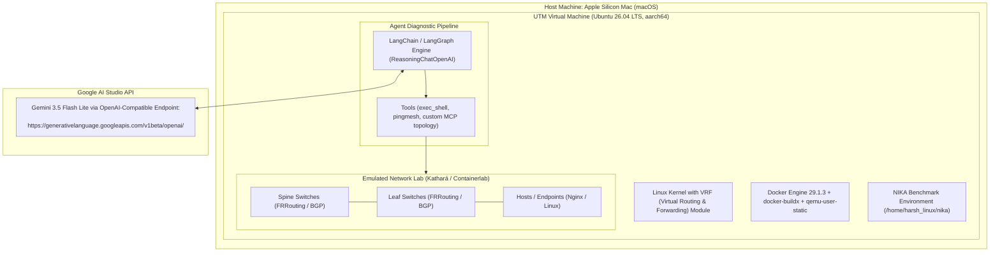

# Topology-Aware Tool-Using LLM Agent for Automated Network Fault Diagnosis

[](https://www.python.org/)
[](https://github.com/sands-lab/nika)
[](https://aistudio.google.com/)
[](https://opensource.org/licenses/MIT)

An empirical research project investigating whether providing Large Language Model (LLM) agents with **structured graph-based topological context** improves root-cause analysis (RCA) and diagnostic efficiency in emulated data center networks.

Developed as **B.Tech Project-I** at the Department of Information Technology, **Delhi Technological University (DTU)**.

---

## 📌 Executive Summary & Core Results

Modern data center networks (such as multi-tier Clos leaf-spine fabrics running BGP and FRRouting) experience complex distributed failures. While LLM agents equipped with standard CLI diagnostic tools (`ping`, `traceroute`, `show ip bgp`) can troubleshoot networks, they operate largely by trial-and-error without structural knowledge of the network topology.

In this project, we designed and integrated a **read-only Model Context Protocol (MCP) Topology Server** (`list_devices`, `list_neighbours`, `find_path`) into the **NIKA benchmark** (`sands-lab/nika`) to compare:
- **Version (b) — Baseline Agent:** Standard diagnostic tools, no topology awareness.
- **Version (c) — Proposed Agent:** Standard diagnostic tools + Model Context Protocol (MCP) topology server.

### 📊 Measured Empirical Results (`dc_clos_s_link_down`)

| Metric | Version (b): Baseline | Version (c): Topology-Aware | Impact / Gain |
| :--- | :---: | :---: | :--- |
| **Root-Cause F1 (`rca_f1`)** | **1.000 (100%)** | **1.000 (100%)** | **Parity (Both 100% Correct)** |
| **Localization Precision / Recall** | **1.000** | **1.000** | **Parity (Exact Link Pinpointed)** |
| **Diagnosis Latency (Wall-clock)** | **64.4s** | **42.5s** | **⚡ -21.9s (-34.0% Faster)** |
| **Prompt Input Tokens** | 66,524 | 60,448 | **📉 -6,076 (-9.1% Reduction)** |
| **Completion Output Tokens** | 1,123 | 926 | **📉 -197 (-17.5% Reduction)** |
| **Decision Steps** | 15 | 14 | **📉 1 Step Fewer** |
| **Tool Calls to Solution** | 14 | 13 | **📉 1 Tool Call Fewer** |
| **Tool Errors** | 0 | 0 | Clean execution |

---

## 🏗️ System Architecture



---

## 🛠️ Repository Structure

```text
├── README.md                           # Master project documentation
├── docs/
│   ├── DTU_PROJECT_REPORT.md           # Full 1,000+ line academic report (DTU format)
│   ├── TECHNICAL_HANDOFF.md            # In-depth technical architecture and bug fix log
│   ├── PROJECT_OVERVIEW.md             # High-level executive overview and roadmap
│   └── LAYMAN_SUMMARY.md               # Plain-English explanation and viva presentation guide
├── src/
│   ├── topology_server.py              # Pure-Python read-only MCP Topology Server
│   └── thought_signature_patch.py     # Monkey patch for LangChain thought_signature support
├── results/
│   ├── version_b_smoke_test.json       # Baseline smoke test raw metrics
│   └── version_c_smoke_test.json       # Topology-aware smoke test raw metrics
└── .gitignore                          # Standard git ignore rules
```

---

## 🚀 Key Technical Breakthroughs

1. **Kernel VRF Virtualization:** Set up an Ubuntu 26.04 ARM64 VM on UTM to provide the Linux kernel `vrf` module required by NIKA.
2. **On-Line LVM Expansion:** Dynamically expanded the VM's root partition from 12 GB to 24 GB to accommodate multi-container image compilation.
3. **LangChain Thought Signature Bug Resolution:** Solved an industry-wide schema mismatch where LangChain dropped Google's cryptographic `thought_signature` on multi-turn function calls, enabling robust Gemini 3.x tool execution.
4. **Zero-Dependency Topology Server:** Implemented a lightweight, graph-traversal MCP server using standard library BFS queues, returning valid Clos ECMP paths in under 1 millisecond.

---

## 📖 Complete Academic Report

The complete B.Tech project report formatted to official Delhi Technological University guidelines (including Declaration, Certificate, Literature Review of 15 papers, System Architecture, Observations & Results, and Future Scope) is available at:
📄 **[docs/DTU_PROJECT_REPORT.md](docs/DTU_PROJECT_REPORT.md)**

---

## 👨‍💻 Author

**Harsh**  
B.Tech in Information Technology (Batch 2023–2027)  
Delhi Technological University (DTU), Delhi, India  
GitHub: [@Harshvardhan-2005](https://github.com/Harshvardhan-2005)
