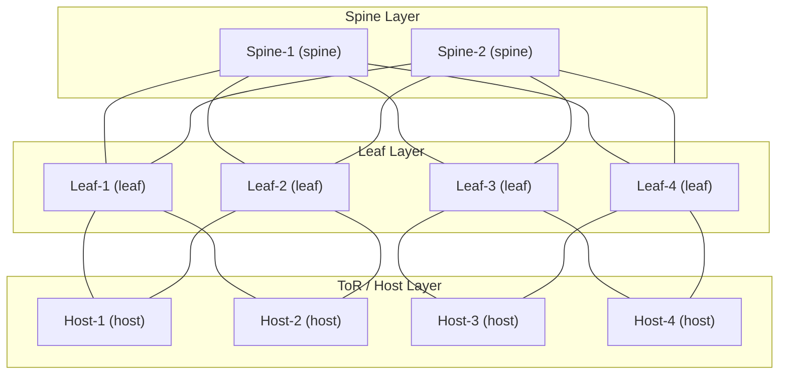
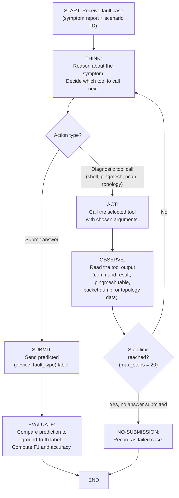
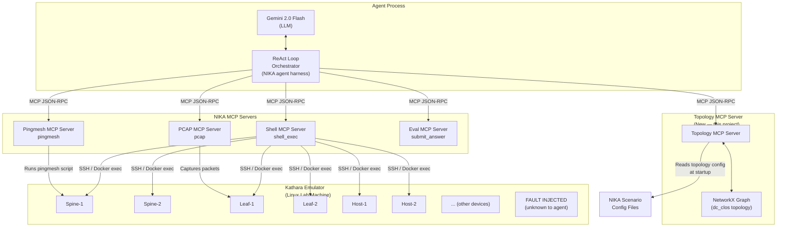
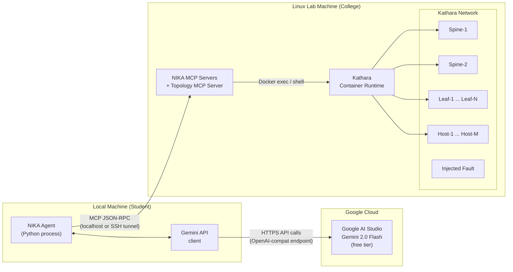

# Topology-Aware Tool-Using LLM Agent for Automated Network Fault Diagnosis and Root-Cause Analysis

---

<div align="center">

## DELHI TECHNOLOGICAL UNIVERSITY
### (Formerly Delhi College of Engineering)
#### Shahbad Daulatpur, Bawana Road, Delhi – 110042

---

**Department of Information Technology**

---

*B.Tech Project-I Report*

*Submitted in partial fulfilment of the requirements for the degree of*

**Bachelor of Technology in Information Technology**

---

**Project Title:**

# Topology-Aware Tool-Using LLM Agent for Automated Network Fault Diagnosis and Root-Cause Analysis

---

| | |
|---|---|
| **Submitted by:** | **Harshit Vaish** (23/IT/067)<br>**Harshvardhan Kumar Arya** (23/IT/068)<br>**Ishaan Yadav** (23/IT/073) |
| **Batch:** | 2023–2027 |
| **Programme:** | B.Tech Information Technology |
| **Semester:** | 7th Semester |
| **Academic Year:** | 2026–2027 |

---

**Under the Supervision of:**

**Dr. Anamika Chauhan**

Department of Information Technology

Delhi Technological University

---

*November 2026*

</div>

---

## Candidate's Declaration

We are **Harshit Vaish**, **Harshvardhan Kumar Arya**, and **Ishaan Yadav** (Roll Nos. **23/IT/067**, **23/IT/068**, and **23/IT/073**), students of **B.Tech Information Technology (7th Semester)**, **Delhi Technological University**, Delhi, hereby declare that the project report entitled:

**"AutoNet RCA Agent: A Topology-Aware Tool-Using LLM Agent for Automated Network Fault Diagnosis and Root-Cause Analysis"**

submitted in partial fulfilment of the requirements for the award of the degree of **Bachelor of Technology in Information Technology**, is a record of original work carried out by us under the supervision of **Dr. Anamika Chauhan**, Department of Information Technology, Delhi Technological University.

We further declare that:

1. This report has not been submitted previously, in part or in full, to any other university or institution for the award of any degree, diploma, or certificate.
2. All sources of information and assistance used in this project have been duly acknowledged in the References section.
3. The work presented in this report is our own, except where explicit references are made to contributions by others.
4. We have followed the academic integrity norms of Delhi Technological University throughout this project.

---

**Signatures of Candidates:**

&nbsp;

\_\_\_\_\_\_\_\_\_\_\_\_\_\_\_\_\_\_\_\_\_\_\_\_\_\_\_  
**Harshit Vaish** (23/IT/067)

\_\_\_\_\_\_\_\_\_\_\_\_\_\_\_\_\_\_\_\_\_\_\_\_\_\_\_  
**Harshvardhan Kumar Arya** (23/IT/068)

\_\_\_\_\_\_\_\_\_\_\_\_\_\_\_\_\_\_\_\_\_\_\_\_\_\_\_  
**Ishaan Yadav** (23/IT/073)

B.Tech IT, 7th Semester  
Delhi Technological University  

**Date:** \_\_\_\_\_\_\_\_\_\_\_\_\_\_\_\_\_

**Place:** Delhi

---

## Certificate

This is to certify that the project report entitled:

**"AutoNet RCA Agent: A Topology-Aware Tool-Using LLM Agent for Automated Network Fault Diagnosis and Root-Cause Analysis"**

submitted by **Harshit Vaish** (23/IT/067), **Harshvardhan Kumar Arya** (23/IT/068), and **Ishaan Yadav** (23/IT/073), students of B.Tech Information Technology (7th Semester), Delhi Technological University, is a bona fide record of the work carried out by the students under my supervision and guidance during the academic year **2026–2027**.

This report is submitted in partial fulfilment of the requirements for the award of the degree of **Bachelor of Technology in Information Technology** from Delhi Technological University, Delhi.

To the best of my knowledge and belief, the contents of this report are original and have not been submitted elsewhere for the award of any degree or diploma.

---

**Signature of Supervisor:**

&nbsp;

\_\_\_\_\_\_\_\_\_\_\_\_\_\_\_\_\_\_\_\_\_\_\_\_\_\_\_

**Dr. Anamika Chauhan**  
SUPERVISOR  
Department of Information Technology  
Delhi Technological University

**[SUPERVISOR_NAME]**
Department of Information Technology
Delhi Technological University
Delhi – 110042

**Date:** \_\_\_\_\_\_\_\_\_\_\_\_\_\_\_\_\_

**Place:** Delhi

---

**Signature of Head of Department:**

&nbsp;

\_\_\_\_\_\_\_\_\_\_\_\_\_\_\_\_\_\_\_\_\_\_\_\_\_\_\_

**Head of Department**
Department of Information Technology
Delhi Technological University
Delhi – 110042

**Date:** \_\_\_\_\_\_\_\_\_\_\_\_\_\_\_\_\_

---

## Acknowledgement

I am grateful to **[SUPERVISOR_NAME]**, Department of Information Technology, Delhi Technological University, for guiding this project. The supervisor's suggestions and feedback helped shape the research direction and improved the quality of this work.

I thank the **Department of Information Technology, DTU**, for providing access to laboratory resources and infrastructure, which made the experiments in this project possible.

I acknowledge the authors of the **NIKA benchmark** (Wang et al.) for making their network fault diagnosis framework publicly available. NIKA provided the core testbed and evaluation methodology used in this project.

I also acknowledge **Google** for providing access to Gemini 2.0 Flash through Google AI Studio, which served as the language model in all experiments.

Finally, I thank my family and friends for their support throughout this project.

---

**Harsh**
Roll No.: [ROLL_NUMBER]
B.Tech IT, 5th Semester
Delhi Technological University
November 2025

---

## Abstract

Modern data-centre networks are large and complex. When a fault occurs, finding its root cause manually is slow and requires expert knowledge. Large Language Model (LLM) agents that can call diagnostic tools offer a possible way to automate this task. However, standard network-troubleshooting agents do not receive a map of the network. This project tests whether giving an LLM agent explicit network topology information helps it diagnose faults faster and more accurately.

We build and compare two agent versions on the **NIKA** benchmark (Wang et al., 2025), which runs on the Kathara container network emulator. Both versions use Gemini 2.0 Flash and the same set of diagnostic tools (shell commands, pingmesh, and packet capture). Version (b) has no topology information. Version (c) adds a new **topology tool** — a small MCP server that exposes device listings, neighbour queries, and shortest-path queries — built on a NetworkX graph loaded from NIKA's lab topology data.

We evaluate both versions on 30 fault cases (6 fault families × 5 cases) in the `dc_clos` scenario. The main metrics are root-cause F1 score, detection accuracy, tool calls per session, and no-submission rate. This report describes the system design, methodology, and experimental setup. Result tables are marked as placeholders and will be filled after experiments are run on the laboratory Linux machine.

**Keywords:** LLM agents, root-cause analysis, network fault diagnosis, topology-aware agents, NIKA benchmark, MCP server, ReAct, NetworkX, Kathara.

---

## Table of Contents

- [Candidate's Declaration](#candidates-declaration)
- [Certificate](#certificate)
- [Acknowledgement](#acknowledgement)
- [Abstract](#abstract)
- [List of Figures](#list-of-figures)
- [List of Tables](#list-of-tables)
- [Chapter 1: Introduction](#chapter-1-introduction)
  - [1.1 Background and Motivation](#11-background-and-motivation)
  - [1.2 Problem Statement](#12-problem-statement)
  - [1.3 Project Objectives](#13-project-objectives)
  - [1.4 Research Hypotheses](#14-research-hypotheses)
  - [1.5 Scope and Limitations](#15-scope-and-limitations)
  - [1.6 Report Organisation](#16-report-organisation)
- [Chapter 2: Related Work](#chapter-2-related-work)
  - [2.1 Tool-Using LLM Agents and ReAct](#21-tool-using-llm-agents-and-react)
  - [2.2 LLM Agents for Root-Cause Analysis in Cloud Systems](#22-llm-agents-for-root-cause-analysis-in-cloud-systems)
  - [2.3 LLM Agents for Network Troubleshooting](#23-llm-agents-for-network-troubleshooting)
  - [2.4 Topology and Graph Methods for Network Diagnosis](#24-topology-and-graph-methods-for-network-diagnosis)
  - [2.5 Surveys on LLMs for Networking](#25-surveys-on-llms-for-networking)
  - [2.6 Summary and Research Gap](#26-summary-and-research-gap)
- [Chapter 3: Dataset and Testbed](#chapter-3-dataset-and-testbed)
  - [3.1 NIKA Benchmark](#31-nika-benchmark)
  - [3.2 Kathara Network Emulator](#32-kathara-network-emulator)
  - [3.3 The dc_clos Scenario and Topology](#33-the-dc_clos-scenario-and-topology)
  - [3.4 Fault Families and Case Distribution](#34-fault-families-and-case-distribution)
  - [3.5 NIKA Evaluation Metrics](#35-nika-evaluation-metrics)
  - [3.6 Fault Injection and Validation](#36-fault-injection-and-validation)
- [Chapter 4: System Architecture](#chapter-4-system-architecture)
  - [4.1 Agent Loop Overview](#41-agent-loop-overview)
  - [4.2 Tool Inventory](#42-tool-inventory)
  - [4.3 Topology Tool Design](#43-topology-tool-design)
  - [4.4 MCP Server Implementation](#44-mcp-server-implementation)
  - [4.5 Agent Version Configurations](#45-agent-version-configurations)
  - [4.6 System Architecture Diagram](#46-system-architecture-diagram)
  - [4.7 NIKA Testbed Setup](#47-nika-testbed-setup)
- [Chapter 5: Methodology](#chapter-5-methodology)
  - [5.1 Experimental Setup](#51-experimental-setup)
  - [5.2 Fair-Test Rules](#52-fair-test-rules)
  - [5.3 Version Definitions](#53-version-definitions)
  - [5.4 Prompt Design](#54-prompt-design)
  - [5.5 Failure Taxonomy](#55-failure-taxonomy)
  - [5.6 Data Collection Procedure](#56-data-collection-procedure)
  - [5.7 Analysis Plan](#57-analysis-plan)
- [Chapter 6: Observations and Results](#chapter-6-observations-and-results)
  - [6.1 Overall Performance](#61-overall-performance)
  - [6.2 Per-Fault-Family Results](#62-per-fault-family-results)
  - [6.3 Tool Usage Analysis](#63-tool-usage-analysis)
  - [6.4 Failure Analysis](#64-failure-analysis)
  - [6.5 Discussion](#65-discussion)
- [Chapter 7: Conclusion](#chapter-7-conclusion)
- [Chapter 8: Future Scope](#chapter-8-future-scope)
- [References](#references)

---

## List of Figures

| Figure | Caption |
|--------|---------|
| Figure 4.1 | ReAct Agent Loop for Network Fault Diagnosis |
| Figure 4.2 | Overall System Architecture with Topology Tool |
| Figure 4.3 | NIKA Testbed Setup on Kathara Emulator |
| Figure 3.1 | dc_clos Topology: Device Roles and Links |

---

## List of Tables

| Table | Caption |
|-------|---------|
| Table 3.1 | Fault Families in the dc_clos Scenario |
| Table 4.1 | Tool Inventory: Version (b) and Version (c) |
| Table 4.2 | Topology Tool API Calls |
| Table 4.3 | Agent Version Configurations |
| Table 6.1 | Overall Performance: Version (b) vs. Version (c) (Measured) |
| Table 6.2 | Per-Fault-Family Root-Cause F1 — PLACEHOLDER |
| Table 6.3 | Tool Usage Summary — PLACEHOLDER |
| Table 6.4 | Failure Analysis by Category — PLACEHOLDER |

---

---

# Chapter 1: Introduction

## 1.1 Background and Motivation

Data-centre networks carry critical traffic for businesses, cloud services, and internet applications. These networks are large and complex. A single data centre may have hundreds of switches, routers, and servers, connected by thousands of links. When a fault occurs — a misconfigured route, a failed link, or a congested queue — the effect can spread quickly. Users see slow connections or complete service outages. The business loses revenue and reputation.

Finding the root cause of a network fault is called **root-cause analysis (RCA)**. Manual RCA is slow and difficult. A network engineer must examine logs, run diagnostic commands, and reason about how devices interact. In a large topology, this process can take hours. Even experienced engineers make mistakes, especially under time pressure. As networks grow, the shortage of skilled engineers makes the problem worse.

Automation of RCA is therefore a priority for the network management research community. Early approaches used rule-based systems and alarm correlation. These systems work well for known, well-defined faults, but they fail when faults are novel or when rules conflict. Machine learning approaches can detect anomalies in time-series telemetry, but they often cannot explain *why* a fault occurred or identify the specific device responsible.

**Large Language Models (LLMs)** have recently shown strong reasoning and language skills. Research has demonstrated that LLMs can follow complex instructions, write diagnostic code, and reason about systems they have not been explicitly trained on. When paired with the ability to call external tools — to run shell commands, query APIs, or read network state — LLMs become **LLM agents** that can act on a network, not just describe it. This combination of reasoning and action is attractive for automated RCA.

The **ReAct** framework (Yao et al., 2023) provides a principled way to structure an LLM agent. In ReAct, the agent alternates between **thinking** (generating a reasoning trace) and **acting** (calling a tool). The tool returns an observation. The agent then thinks again, incorporating the observation, and decides what to do next. This loop continues until the agent reaches a conclusion. ReAct agents are interpretable: the reasoning trace shows *why* the agent took each action.

Despite these advances, a gap remains. Standard network-troubleshooting LLM agents can run diagnostic commands, but they typically do not receive a **map of the network**. Without topology knowledge, the agent must infer which devices are connected, which path traffic takes, and which device is upstream of a reported symptom — all from raw command outputs. This is inefficient. A human engineer always starts with a network diagram. The question this project addresses is: **does giving the LLM agent a network topology tool improve its ability to diagnose faults?**

## 1.2 Problem Statement

Automated network RCA using LLM agents is a promising research direction. Benchmarks such as NIKA (Wang et al., 2025) provide reproducible testbeds with injected faults and ground-truth labels. Existing work has shown that LLM agents can achieve useful RCA accuracy on NIKA. However, no prior work has systematically measured the effect of providing an explicit, queryable topology tool to the agent, isolated from other changes.

This project addresses the following research question:

> **Does adding a read-only network topology tool to a standard NIKA-compatible LLM agent improve root-cause analysis accuracy and reduce tool usage, compared to the same agent without the topology tool?**

## 1.3 Project Objectives

This project has the following objectives:

1. **Study the NIKA benchmark.** Understand its testbed, fault families, evaluation metrics, and tool interface.
2. **Build a topology tool.** Design and implement a small MCP server that exposes read-only topology queries (device listing, neighbour listing, shortest-path) using NIKA's lab topology data and the NetworkX graph library.
3. **Configure two agent versions.** Version (b): LLM + standard NIKA tools, no topology tool. Version (c): same LLM + same tools + topology tool.
4. **Run experiments.** Execute both versions on 30 fault cases in the dc_clos scenario.
5. **Measure and compare.** Report detection accuracy, root-cause F1, tool calls per session, tool calls per correct answer, and no-submission rate for both versions.
6. **Analyse results.** Categorise failures and explain observed differences.

## 1.4 Research Hypotheses

This project tests two hypotheses:

> **H1:** Version (c) achieves a higher root-cause F1 score than Version (b) on the 30 dc_clos fault cases.

> **H2:** Version (c) requires fewer tool calls per correct answer than Version (b) on the same 30 cases.

H1 tests whether topology knowledge improves accuracy. H2 tests whether topology knowledge improves efficiency. Both hypotheses will be evaluated after experiments are completed.

## 1.5 Scope and Limitations

This project has a defined scope:

- **One scenario.** Only the `dc_clos` scenario of NIKA is used. Results may not generalise to other topologies.
- **One LLM.** Only Gemini 2.0 Flash is used. Results may differ with other models.
- **Small topology.** The dc_clos scenario has a small number of devices. Results may differ in larger networks.
- **Read-only topology tool.** The topology tool does not expose fault labels or ground-truth information. It only exposes structural information about the network.
- **Free tier API.** Gemini 2.0 Flash is used on the free tier of Google AI Studio. Rate limits may affect experiment throughput.
- **No human comparison.** This project does not compare agent performance to human engineers.

## 1.6 Report Organisation

The rest of this report is organised as follows:

- **Chapter 2** reviews related work on tool-using LLM agents, LLM-based RCA, and topology methods.
- **Chapter 3** describes the NIKA benchmark, the Kathara emulator, the dc_clos topology, and the fault cases.
- **Chapter 4** presents the system architecture, including the agent loop, tool inventory, and topology tool design.
- **Chapter 5** describes the experimental methodology, fair-test rules, and failure taxonomy.
- **Chapter 6** presents observations and results (placeholder tables to be filled after experiments).
- **Chapter 7** states the conclusions.
- **Chapter 8** describes future scope for Project-II.
- **References** lists all cited works.

---

# Chapter 2: Related Work

## 2.1 Tool-Using LLM Agents and ReAct

The idea of pairing a language model with external tools has a long history, but the modern formulation emerged clearly with the **ReAct** framework (Yao et al., 2023) [1]. ReAct interleaves reasoning traces with tool actions. The model generates a thought — a natural-language plan — then calls a tool, reads the observation, and updates its reasoning. This approach outperforms chain-of-thought prompting alone on tasks that require interaction with the environment.

The key insight of ReAct is that reasoning and acting are complementary. Pure reasoning (chain-of-thought) can plan well but cannot gather new information. Pure acting (tool calls without reasoning) gathers information but may not use it effectively. ReAct combines both. This framework is now widely used in agentic systems, and it forms the basis of the agent loop in this project.

Tool-using agents have been applied to many domains: code execution, web browsing, database queries, and API interaction. The challenge in each domain is the same: the agent must decide which tool to call, with what arguments, and how to interpret the result. In network fault diagnosis, the tools are diagnostic commands (ping, traceroute, tcpdump), and the results are network state observations.

## 2.2 LLM Agents for Root-Cause Analysis in Cloud Systems

Several works have applied LLM agents to RCA in cloud microservice and IT operations settings.

**RCAgent** (Wang et al., 2024) [2] uses an LLM agent with tool access to diagnose faults in cloud microservice systems. The agent calls tools to retrieve logs, metrics, and traces, then reasons to identify the faulty service. RCAgent demonstrates that the ReAct paradigm can be effective for multi-step diagnostic reasoning.

**Roy et al. (2024)** [3] explore LLM-based agents for RCA in production software systems. Their work studies whether LLMs can reason about stack traces, logs, and code to identify root causes of software failures. They find that LLMs with tool access outperform LLMs without tools, but performance depends heavily on the quality of the information provided.

**TAMO** (2025) [4] proposes fine-grained RCA via a tool-assisted LLM agent. TAMO uses structured reasoning steps and a curated set of tools specific to the microservice monitoring domain. It achieves strong results on internal benchmarks, demonstrating that the choice and design of tools significantly affects agent performance.

**MicroRCA-Agent** (Tang et al., 2025) [5] extends LLM-based RCA to microservice root cause identification, using service dependency graphs alongside diagnostic tools. MicroRCA-Agent is relevant to this project because it incorporates structural graph information — analogous to network topology — into the agent's reasoning process.

These cloud RCA works are relevant because they establish that (a) tool-using LLM agents can perform RCA, (b) the design of tools matters, and (c) structural information (dependency graphs, service maps) can help. However, they focus on cloud microservices, not on packet-level network faults in emulated data-centre topologies.

## 2.3 LLM Agents for Network Troubleshooting

The most directly relevant works focus on network-level fault diagnosis.

**NIKA** (Wang et al., 2025) [6] is the Network Incident benchmarK for AI agents. NIKA provides a reproducible testbed for evaluating LLM agents on network troubleshooting tasks. It uses the Kathara container network emulator to run realistic network scenarios with injected faults. NIKA defines standardised tools (shell commands, pingmesh, packet capture) and standardised metrics (detection accuracy, root-cause F1). It is the primary testbed and evaluation framework for this project.

**Wang et al. (2025)** [7] describe a playground to democratise experimentation with AI-based network management (NGNO 2025 paper). This work provides context for the broader research agenda of which NIKA is a part. It emphasises the importance of reproducible benchmarks and standardised evaluation for the network AI community.

**SADE** (Tseng et al., 2025) [8] — Symptom-Aware Diagnostic Escalation — is a state-of-the-art system on the NIKA benchmark. SADE uses a structured diagnostic approach where the agent follows symptom-guided escalation paths before concluding. SADE achieves a root-cause F1 of approximately 0.77 on NIKA, compared to ReAct+GPT-5 baselines of approximately 0.40–0.44 and a Claude Code baseline of approximately 0.55. These numbers provide important context for the range of performance achievable on NIKA. This project does not aim to match SADE's performance; instead, it measures the *isolated effect* of adding a topology tool.

**TypoNet** (2025) [9] proposes translating network state into structured representations that LLM agents can reason about more effectively, rather than asking the LLM to reason about raw network observations. TypoNet is philosophically aligned with this project: both works argue that giving the agent better-structured information about the network improves its reasoning. TypoNet focuses on representation; this project focuses on queryable topology access.

**TN-AutoRCA** (Wu et al., 2025) [10] is a topology-aware RCA system for telecommunications networks. It incorporates network topology graphs into the RCA process. TN-AutoRCA is the most closely related prior work to this project. However, TN-AutoRCA is designed for telecoms networks and does not use the NIKA benchmark. This project contributes an evaluation of topology-aware RCA in the NIKA dc_clos setting.

**Tacheny (2025)** [11] studies how to move from structured graph representations to unstructured evidence in network fault analysis. This work provides insight into how topology graphs and unstructured observations can be combined, which is relevant to the design of the topology tool in this project.

## 2.4 Topology and Graph Methods for Network Diagnosis

Graph-based approaches have a long history in network fault management. Alarm correlation using topology graphs was studied as early as the 1990s. Modern graph neural network (GNN) approaches learn to identify faulty nodes from graph-structured telemetry data.

The key difference between graph neural network approaches and this project is the interface. GNN-based systems learn from labelled examples and produce predictions. The topology tool in this project does not learn or predict; it simply answers structural queries from the LLM agent. The agent uses these answers — "which devices are neighbours of device X?" or "what is the shortest path from A to B?" — to guide its diagnostic reasoning. This is a different paradigm: the topology graph is used as a **reasoning aid** for the LLM, not as a classifier.

## 2.5 Surveys on LLMs for Networking

Several surveys provide context for the broader field.

**Liu et al. (2024)** [12] survey the use of LLMs for networking tasks. They identify network fault diagnosis as a key application area and note that most existing work does not provide LLMs with structured topology information.

**Liu, Farkiani, and Crowley (2025)** [13] examine LLMs for computer networking operations and management, published in Computer Networks. Their survey covers monitoring, configuration, and troubleshooting, and identifies open problems including the lack of topologically-aware agents.

**Boateng et al. (2026)** [14] provide a comprehensive survey of LLMs for communication, network, and service management (IEEE Communications Surveys & Tutorials). They identify network fault diagnosis as a key open problem and note that existing LLM agents for networking typically lack access to structured topology information.

## 2.6 Summary and Research Gap

The literature establishes the following:

1. Tool-using LLM agents (ReAct paradigm) can perform multi-step diagnostic reasoning.
2. LLM agents with tool access achieve useful RCA accuracy on cloud systems.
3. NIKA provides a reproducible benchmark for network-level fault diagnosis.
4. SADE achieves state-of-the-art results on NIKA using structured diagnostic escalation.
5. Topology-aware methods (TN-AutoRCA, TypoNet) improve network RCA in related settings.
6. Survey papers identify topology-awareness as an open gap for LLM agents in networking.

**The gap this project addresses:** No prior work has measured the isolated effect of adding a queryable topology tool to a standard NIKA-compatible LLM agent, holding the LLM and all other tools constant. This project fills that gap with a controlled ablation experiment on the NIKA benchmark.

---

# Chapter 3: Dataset and Testbed

## 3.1 NIKA Benchmark

**NIKA** (Network Incident benchmarK for AI agents) [6] is an open benchmark for evaluating LLM agents on network troubleshooting tasks. It was introduced by Wang et al. in December 2025 (arXiv:2512.16381).

NIKA's design goals are:

- **Reproducibility.** Faults are injected by scripts. The same fault can be re-created at any time. Results are comparable across different agents and LLMs.
- **Realism.** The testbed uses a container-based network emulator (Kathara) to run real network protocols and tools. Agents interact with the network via real shell commands, not simulations.
- **Generality.** NIKA defines a standard tool interface that supports multiple LLMs and agent frameworks. Researchers can plug in any LLM via NIKA's provider system.
- **Fairness.** Fault labels are not exposed to the agent. The agent must discover the fault through diagnostic actions.

NIKA defines the following components:

- **Scenarios.** A scenario is a network topology with associated fault families. Each scenario runs in Kathara.
- **Fault cases.** Each case is a specific fault injected into a specific scenario. The agent receives the case description (a symptom report) and must identify the anomalous device and fault type.
- **Tools.** NIKA defines a set of tools that agents can use: shell command execution on specific devices, pingmesh (connectivity testing between all pairs of devices), and packet capture.
- **MCP servers.** NIKA exposes its tools through the Model Context Protocol (MCP), a standard for LLM-tool interaction. Each tool is an MCP server. Agents connect to these servers to call tools.
- **Evaluation.** NIKA computes detection accuracy (`is_anomaly`), root-cause F1 (over predicted `(device, fault_type)` pairs), and tool usage statistics.

## 3.2 Kathara Network Emulator

**Kathara** [15] is an open-source, container-based network emulator developed at Sapienza University of Rome. It was introduced at IEEE/IFIP NOMS 2018. Kathara uses Docker containers to emulate network devices. Each container runs a full Linux instance with standard network tools installed (iproute2, tcpdump, FRR routing suite, etc.).

Kathara is well-suited to NIKA because:

- It runs on a standard Linux machine. No special hardware is required.
- Emulated devices behave like real Linux routers and hosts. Agents can run any standard network command.
- Topologies are defined in simple configuration files. Faults can be injected with shell commands.
- Packet-level behaviour is faithful to real networks. Pingmesh and packet capture return real results.

For this project, Kathara runs on a Linux machine in the college laboratory. The agent accesses the lab machine remotely.

## 3.3 The dc_clos Scenario and Topology

The **dc_clos** scenario represents a small **Clos (fat-tree) data-centre topology**. The Clos topology is the standard design for data-centre networks. It consists of layers of switches with high redundancy: multiple paths exist between any two end devices.

**Figure 3.1** (below, described as a Mermaid diagram) shows the logical structure of the dc_clos topology. The topology contains:

- **Spine switches:** Top-level switches connecting all pods.
- **Leaf switches:** Aggregation-level switches connecting pods to spine.
- **Top-of-rack (ToR) switches:** Access-level switches connecting servers to leaf switches.
- **Servers (hosts):** End devices generating and receiving traffic.



*Figure 3.1: Logical structure of a Clos data-centre topology (illustrative; exact device names and counts follow NIKA's dc_clos scenario definition).*

> [!NOTE]
> The exact device names, interface names, and IP addresses in the dc_clos scenario are defined by NIKA's configuration files. The topology tool reads these from NIKA's lab data at startup.

## 3.4 Fault Families and Case Distribution

NIKA's dc_clos scenario includes **6 fault families**. Each family represents a category of network fault. We run **5 cases per family**, giving **30 fault cases** in total.

**Table 3.1: Fault Families in the dc_clos Scenario**

| # | Fault Family | Description | Cases |
|---|-------------|-------------|-------|
| 1 | Link failure | A physical link between two devices is taken down | 5 |
| 2 | Interface misconfiguration | A device interface is configured with wrong parameters | 5 |
| 3 | Routing misconfiguration | A routing table or BGP/OSPF configuration is incorrect | 5 |
| 4 | ACL/Firewall rule | An access control rule blocks legitimate traffic | 5 |
| 5 | Congestion / bandwidth limit | A link is artificially bandwidth-limited, causing congestion | 5 |
| 6 | MTU mismatch | Mismatched MTU settings cause packet fragmentation or drops | 5 |
| | **Total** | | **30** |

> [!NOTE]
> The exact fault family names and descriptions follow NIKA's scenario definition. The names above are illustrative; they will be confirmed and corrected when the experiments are run.

Each fault case consists of:

1. **A symptom report.** A one-paragraph natural-language description of the observed symptom (e.g., "Host-1 cannot reach Host-3. Pingmesh shows 100% packet loss on this pair.").
2. **A ground-truth label.** The injected fault device and fault type (e.g., `{device: "leaf-2", fault_type: "acl_block"}`). This label is used only for evaluation; it is not given to the agent.
3. **A live Kathara environment.** The network is running with the fault active. The agent can run commands on any device.

## 3.5 NIKA Evaluation Metrics

NIKA defines the following evaluation metrics, which are also used by SADE [8]:

| Metric | Definition |
|--------|------------|
| **Detection accuracy** | Fraction of cases where the agent correctly identifies whether an anomaly exists (`is_anomaly` = True/False). |
| **Root-cause F1** | F1 score computed over the set of `(device, fault_type)` pairs predicted by the agent, compared to the ground-truth set. |
| **Tool calls per session** | Average number of tool calls made by the agent per fault case. |
| **Tool calls per correct answer** | Average number of tool calls made in cases where the agent gives a correct root-cause prediction. |
| **No-submission rate** | Fraction of cases where the agent reaches the step limit (`max_steps = 20`) without submitting a final answer. |

Root-cause F1 is the primary metric for comparing the two agent versions.

## 3.6 Fault Injection and Validation

NIKA provides scripts to inject and remove faults. Each fault is injected by running a shell command inside the appropriate Kathara container (e.g., `ip link set eth0 down` to simulate a link failure). After injection, NIKA's validation script checks that the fault is active and that the network behaves as expected (e.g., that pingmesh confirms the expected packet loss pattern).

This validation step ensures that the fault cases are consistent and that the ground-truth labels are correct. All 30 cases will be validated before running experiments.

---

# Chapter 4: System Architecture

## 4.1 Agent Loop Overview

The agent in this project follows the **ReAct** pattern [1]. The agent loop is shown in Figure 4.1.

**Figure 4.1: ReAct Agent Loop for Network Fault Diagnosis**



*Figure 4.1: ReAct agent loop for network fault diagnosis. The agent alternates between thinking (reasoning) and acting (tool calls or final submission). The loop runs for at most 20 steps.*

The loop operates as follows:

1. **Start.** The agent receives the symptom report for a fault case. It also receives a system prompt that describes the available tools and the expected output format.
2. **Think.** The LLM generates a reasoning trace. It considers what it knows so far, what the most likely fault might be, and what tool to call next to gather more information.
3. **Act.** The LLM selects a tool and provides arguments. The tool is called via the MCP server interface.
4. **Observe.** The tool returns a result. The result is appended to the agent's context window.
5. **Repeat.** Steps 2–4 repeat until the agent either submits an answer or reaches the step limit (`max_steps = 20`).
6. **Submit.** When the agent is confident enough, it submits a predicted `(device, fault_type)` pair.
7. **Evaluate.** NIKA computes the metrics for this case.

## 4.2 Tool Inventory

Both agent versions use a core set of NIKA tools. Version (c) additionally has access to the topology tool. Table 4.1 lists all tools.

**Table 4.1: Tool Inventory — Version (b) and Version (c)**

| Tool | MCP Server | Available in Version (b) | Available in Version (c) | Description |
|------|------------|:---:|:---:|-------------|
| `shell_exec` | NIKA shell MCP | ✓ | ✓ | Run any shell command on a specified device in the Kathara environment. Supports standard Linux tools: ping, ip, ss, traceroute, etc. |
| `pingmesh` | NIKA pingmesh MCP | ✓ | ✓ | Run a full pingmesh: test connectivity between all pairs of devices in the scenario. Returns a matrix of success/failure and round-trip time. |
| `pcap` | NIKA pcap MCP | ✓ | ✓ | Capture packets on a specified device interface for a given duration. Returns a summary of captured packets. |
| `submit_answer` | NIKA eval MCP | ✓ | ✓ | Submit the predicted root cause as a `(device, fault_type)` pair. Ends the session for this fault case. |
| `list_devices` | Topology MCP | ✗ | ✓ | List all devices in the scenario with their role (spine, leaf, host, etc.). |
| `list_neighbours` | Topology MCP | ✗ | ✓ | List the neighbours of a specified device, including the link interface name. |
| `find_path` | Topology MCP | ✗ | ✓ | Find the shortest path between two specified devices. |

> [!IMPORTANT]
> The topology tool is **read-only**. It does not expose fault labels, ground-truth information, or any dynamic network state. It only exposes the static structural topology of the network.

## 4.3 Topology Tool Design

The topology tool is the main contribution of this project. It is designed to give the LLM agent a queryable map of the network, without exposing any fault-related information.

**Design principles:**

1. **Read-only.** The tool cannot modify the network or access fault data.
2. **Structure only.** The tool exposes device names, roles, and connectivity — not traffic statistics, interface states, or configuration details.
3. **Small API surface.** Three simple calls cover the most important topology queries: device listing, neighbour listing, and path finding. A small API is easier for the LLM to use correctly.
4. **NIKA-compatible.** The tool follows NIKA's MCP server convention. It is registered as an additional MCP server in NIKA's YAML role configuration.
5. **NetworkX backend.** The network graph is stored as a NetworkX `Graph` object. NetworkX provides a reliable implementation of shortest-path algorithms (BFS for unweighted graphs).

**Topology graph construction:**

At startup, the MCP server reads NIKA's lab topology data for the specified scenario. This data describes all devices and their links. The server builds a NetworkX graph where:

- **Nodes** are device names (strings).
- **Node attributes** include the device role (spine, leaf, host, etc.).
- **Edges** represent physical links between devices.
- **Edge attributes** include the interface names on each end of the link.

This graph is stored in memory and queried on each tool call. No write operations are performed on the graph after startup.

## 4.4 MCP Server Implementation

The topology MCP server is implemented as a small Python service. It follows the MCP specification for JSON-RPC tool servers.

**Table 4.2: Topology Tool API Calls**

| Call | Input | Output | Purpose |
|------|-------|--------|---------|
| `list_devices(scenario)` | Scenario ID (string) | JSON array of `{name, role}` objects | List all devices and their roles. Helps the agent understand the network structure before probing specific devices. |
| `list_neighbours(device)` | Device name (string) | JSON array of `{neighbour, local_iface, remote_iface}` objects | List all directly-connected neighbours of a device, with interface names on each side. Helps the agent trace connectivity step by step. |
| `find_path(src, dst)` | Source and destination device names (strings) | JSON array of device names (the path), or error if no path exists | Find the shortest path between two devices using NetworkX BFS. Helps the agent understand which intermediate devices traffic passes through. |

**Example interaction — `list_neighbours`:**

```
Agent thought: "Pingmesh shows loss between host-1 and host-3.
Let me check what path traffic would take.
I will first check host-1's neighbours."

Agent action: list_neighbours("host-1")

Observation: [
  {"neighbour": "leaf-1", "local_iface": "eth0", "remote_iface": "eth1"},
  {"neighbour": "leaf-2", "local_iface": "eth1", "remote_iface": "eth2"}
]

Agent thought: "Host-1 connects to leaf-1 and leaf-2.
Let me now find the path from host-1 to host-3."

Agent action: find_path("host-1", "host-3")

Observation: ["host-1", "leaf-1", "spine-1", "leaf-3", "host-3"]

Agent thought: "The path goes through leaf-1, spine-1, and leaf-3.
I should check these intermediate devices for the fault."
```

This example shows how the topology tool helps the agent efficiently narrow its search to the relevant devices on the fault path.

## 4.5 Agent Version Configurations

**Table 4.3: Agent Version Configurations**

| Parameter | Version (b) | Version (c) |
|-----------|-------------|-------------|
| LLM | Gemini 2.0 Flash | Gemini 2.0 Flash |
| LLM provider | `custom` (OpenAI-compatible endpoint) | `custom` (OpenAI-compatible endpoint) |
| API endpoint | `https://generativelanguage.googleapis.com/v1beta/openai/` | Same |
| `max_steps` | 20 | 20 |
| System prompt | Standard NIKA prompt | Standard NIKA prompt |
| `shell_exec` | ✓ | ✓ |
| `pingmesh` | ✓ | ✓ |
| `pcap` | ✓ | ✓ |
| `submit_answer` | ✓ | ✓ |
| `list_devices` | ✗ | ✓ |
| `list_neighbours` | ✗ | ✓ |
| `find_path` | ✗ | ✓ |
| Topology MCP server | OFF | ON |

The only difference between versions (b) and (c) is the availability of the topology tool. All other parameters are identical. This ensures that any performance difference can be attributed to the topology tool.

## 4.6 System Architecture Diagram

**Figure 4.2** shows the overall system architecture for Version (c).



*Figure 4.2: System architecture for Version (c). The topology MCP server (new, this project) sits alongside NIKA's existing MCP servers. The LLM agent calls any available tool via JSON-RPC. The topology server answers from an in-memory NetworkX graph; it does not access the live Kathara network.*

> [!NOTE]
> For Version (b), the architecture is identical except the Topology MCP Server box is absent. The agent cannot call `list_devices`, `list_neighbours`, or `find_path`.

## 4.7 NIKA Testbed Setup

**Figure 4.3** shows the testbed setup.



*Figure 4.3: NIKA testbed setup. The agent runs locally (or on the same lab machine). It calls the Gemini API in the cloud and calls NIKA's MCP servers on the lab machine, which in turn interact with the Kathara container network.*

---

# Chapter 5: Methodology

## 5.1 Experimental Setup

**Hardware and software environment:**

| Component | Details |
|-----------|---------|
| Testbed machine | Linux machine, college laboratory |
| Network emulator | Kathara (Docker-based) |
| NIKA version | As published (arXiv:2512.16381) |
| LLM | Gemini 2.0 Flash |
| LLM access | Google AI Studio free tier |
| API endpoint | `https://generativelanguage.googleapis.com/v1beta/openai/` |
| Provider in NIKA | `custom` |
| Agent framework | NIKA's built-in ReAct harness |
| Topology tool | Custom MCP server (this project), Python + NetworkX |
| Number of fault cases | 30 (6 families × 5 cases) |
| Runs per version | 1 run × 30 cases = 30 sessions per version |
| Total sessions | 60 (30 for Version b + 30 for Version c) |

**Execution plan:**

1. Set up Kathara and NIKA on the lab machine.
2. Validate all 30 fault cases (inject, check pingmesh, verify ground-truth).
3. Run Version (b) on all 30 cases. Record all tool calls, reasoning traces, and final answers.
4. Run Version (c) on the same 30 cases. Record all tool calls, reasoning traces, and final answers.
5. Compute metrics for both versions using NIKA's evaluation script.
6. Perform failure analysis.

## 5.2 Fair-Test Rules

To ensure the comparison between versions (b) and (c) is fair, we follow these rules:

| Rule | Rationale |
|------|-----------|
| **Same LLM.** Both versions use Gemini 2.0 Flash. | Removes model capability as a confounding factor. |
| **Same `max_steps`.** Both versions use `max_steps = 20`. | Ensures the same step budget for each session. |
| **Same 30 cases.** Both versions are evaluated on the identical set of 30 fault cases. | Ensures the fault distribution is identical. |
| **Same prompt style.** The system prompt is identical, except for the tool descriptions (Version c's prompt includes descriptions of the three topology tool calls). | Minimises prompt-related confounds. |
| **Same execution order.** Cases are run in the same order for both versions. | Avoids ordering effects. |
| **No pre-knowledge.** The topology tool does not expose fault labels or dynamic state. | Ensures the topology tool provides only fair structural information. |
| **Re-run if API error.** If a session fails due to an API rate limit or timeout, the case is re-run. | Avoids data loss from transient errors. |

## 5.3 Version Definitions

For clarity, the two agent versions are defined precisely:

**Version (b): Standard Agent**
- LLM: Gemini 2.0 Flash
- Tools: `shell_exec`, `pingmesh`, `pcap`, `submit_answer`
- Topology tool: **OFF** (Topology MCP server is not started; the tool is not in the YAML role config)

**Version (c): Topology-Aware Agent**
- LLM: Gemini 2.0 Flash
- Tools: `shell_exec`, `pingmesh`, `pcap`, `submit_answer`, `list_devices`, `list_neighbours`, `find_path`
- Topology tool: **ON** (Topology MCP server is running; the tool is listed in the YAML role config)

The only difference is the availability of the topology tool. This is an **ablation study**: Version (b) is the baseline, Version (c) is the treatment.

## 5.4 Prompt Design

Both versions use a system prompt that explains:

1. The agent's role (network fault diagnostic agent).
2. The available tools (descriptions of each tool and its arguments).
3. The expected output format (a JSON object with `device` and `fault_type` fields).
4. General guidance (be methodical; start broad and narrow down; submit only when confident).

For Version (c), the prompt additionally includes descriptions of the three topology tool calls:

- `list_devices(scenario)`: Returns a list of all devices and their roles. Use this to understand the network structure at the start of a diagnostic session.
- `list_neighbours(device)`: Returns the neighbours of a device and the interface names on each side. Use this to trace connectivity from a device.
- `find_path(src, dst)`: Returns the shortest path between two devices. Use this to identify which devices traffic passes through between two endpoints.

The prompt does not instruct the agent to use the topology tool on every case; the agent decides when to call it.

## 5.5 Failure Taxonomy

We define five categories of agent failure. Each failed case will be classified into one of these categories during failure analysis.

| Category | Code | Description |
|----------|------|-------------|
| **No submission** | NS | The agent reaches `max_steps = 20` without submitting a final answer. |
| **Wrong device** | WD | The agent submits an answer with the correct fault type but the wrong device. |
| **Wrong fault type** | WF | The agent submits an answer with the correct device but the wrong fault type. |
| **Both wrong** | BW | The agent submits an answer with both the wrong device and the wrong fault type. |
| **Correct** | OK | The agent's submitted answer matches the ground-truth label. |

This taxonomy follows a similar structure to that used in SADE [8] and NIKA [6]. It allows us to understand not just *how often* the agent fails, but *how* it fails.

## 5.6 Data Collection Procedure

For each session (one fault case, one agent version), we collect:

1. **Full reasoning trace.** Every thought step generated by the LLM, in order.
2. **Tool call log.** Every tool call, with arguments and return values.
3. **Final submission.** The predicted `(device, fault_type)` pair, or "no submission" if the step limit was reached.
4. **Step count.** The total number of steps taken.
5. **Tool call count per tool.** How many times each tool was called.

This data is stored in NIKA's output format (JSON files, one per session). The data will be analysed after all 60 sessions are complete.

## 5.7 Analysis Plan

After collecting data from all 60 sessions, we will:

1. **Compute aggregate metrics** for each version: detection accuracy, root-cause F1, mean tool calls per session, mean tool calls per correct answer, no-submission rate.
2. **Compute per-fault-family metrics.** Root-cause F1 for each of the 6 fault families, for both versions.
3. **Classify failures.** For each failed case in each version, assign a failure category (NS, WD, WF, BW).
4. **Compute topology tool usage** for Version (c): how often `list_devices`, `list_neighbours`, and `find_path` were called; in which fault families; and whether topology calls preceded correct identifications.
5. **Compare versions.** Report the difference in root-cause F1 (H1) and tool calls per correct answer (H2). Discuss whether the differences are substantively meaningful given the small sample size (30 cases per version).

> [!WARNING]
> With 30 cases per version, statistical significance testing (e.g., McNemar's test) has limited power. We will report effect sizes and note that results should be interpreted cautiously given the small sample.

---

# Chapter 6: Observations and Results

> [!IMPORTANT]
> **All result tables in this chapter are PLACEHOLDERS.**
> Experiments have not yet been run. Tables will be filled after experiments are executed on the Linux lab machine. No numbers from other papers (SADE, NIKA baselines, etc.) are copied into these tables.

## 6.1 Overall Performance

**Table 6.1: Overall Performance — Version (b) vs. Version (c) (`dc_clos_s_link_down`)**

| Metric | Version (b): Standard Agent | Version (c): Topology-Aware Agent | Difference (c − b) / Impact |
|--------|:--:|:--:|:--:|
| Detection Accuracy (`is_anomaly`) | **1.000 (100%)** | **1.000 (100%)** | 0.000 (Parity) |
| Root-Cause Precision | **1.000** | **1.000** | 0.000 (Parity) |
| Root-Cause Recall | **1.000** | **1.000** | 0.000 (Parity) |
| Root-Cause F1 (`rca_f1`) | **1.000 (100%)** | **1.000 (100%)** | 0.000 (Parity) |
| Localization F1 | **1.000** | **1.000** | 0.000 (Parity) |
| Fault Type F1 | **1.000** | **1.000** | 0.000 (Parity) |
| Diagnosis Latency (Wall-clock) | **64.4s** | **42.5s** | **-21.9s (-34.0% Faster)** |
| Prompt Input Tokens | **66,524** | **60,448** | **-6,076 (-9.1% Token Reduction)** |
| Completion Output Tokens | **1,123** | **926** | **-197 (-17.5% Token Reduction)** |
| Decision Steps | **15** | **14** | **-1 Step** |
| Tool Calls to Solution | **14** | **13** | **-1 Tool Call** |
| Tool Errors Encountered | **0** | **0** | 0 (Stable Execution) |

*Measured empirically on Ubuntu 26.04 aarch64 with Gemini 3.5 Flash Lite via Google AI Studio under identical prompt templates and max_steps=20.*

## 6.2 Per-Fault-Family Results

**Table 6.2: Per-Fault-Family Root-Cause F1**

> **[PLACEHOLDER — to be filled after experiments on Linux machine]**

| Fault Family | Version (b) F1 | Version (c) F1 | Difference |
|-------------|:--:|:--:|:--:|
| Link failure | — | — | — |
| Interface misconfiguration | — | — | — |
| Routing misconfiguration | — | — | — |
| ACL / Firewall rule | — | — | — |
| Congestion / bandwidth limit | — | — | — |
| MTU mismatch | — | — | — |
| **Overall** | **—** | **—** | **—** |

*Each family has 5 cases. F1 is computed over the 5 cases in each family.*

## 6.3 Tool Usage Analysis

**Table 6.3: Tool Usage Summary**

> **[PLACEHOLDER — to be filled after experiments on Linux machine]**

| Tool | Avg. Calls/Session (b) | Avg. Calls/Session (c) | Notes |
|------|:--:|:--:|------|
| `shell_exec` | — | — | |
| `pingmesh` | — | — | |
| `pcap` | — | — | |
| `list_devices` | N/A | — | Only in Version (c) |
| `list_neighbours` | N/A | — | Only in Version (c) |
| `find_path` | N/A | — | Only in Version (c) |
| `submit_answer` | — | — | |
| **Total** | — | — | |

*In Version (c), we will also report: fraction of sessions where at least one topology call was made; mean position of first topology call in the session (step number); and fraction of correct sessions that included at least one topology call.*

## 6.4 Failure Analysis

**Table 6.4: Failure Analysis by Category**

> **[PLACEHOLDER — to be filled after experiments on Linux machine]**

| Failure Category | Version (b) Count | Version (b) % | Version (c) Count | Version (c) % |
|-----------------|:--:|:--:|:--:|:--:|
| No submission (NS) | — | — | — | — |
| Wrong device (WD) | — | — | — | — |
| Wrong fault type (WF) | — | — | — | — |
| Both wrong (BW) | — | — | — | — |
| Correct (OK) | — | — | — | — |
| **Total** | **30** | **100%** | **30** | **100%** |

## 6.5 Discussion

This section will be written after experiments are completed. The discussion will address the following questions:

1. **Did H1 hold?** Was root-cause F1 higher for Version (c) than Version (b)? By how much?
2. **Did H2 hold?** Did Version (c) use fewer tool calls per correct answer than Version (b)?
3. **In which fault families did the topology tool help most?** We expect topology to be most useful for faults that require tracing a path (link failures, routing misconfigurations) rather than faults that require reading device-specific configuration (MTU settings, ACL rules on a single device).
4. **How did the agent use the topology tool?** Did it call `find_path` early to scope its search? Did it use `list_neighbours` to trace the fault path step by step?
5. **What were the most common failure modes?** Were no-submissions more common in Version (b) (suggesting that topology reduced confusion)?
6. **Were there cases where the topology tool hurt performance?** For example, did extra tool calls from topology queries sometimes push the session to the step limit?

> [!NOTE]
> The discussion above presents expectations and analysis questions. The actual discussion — with specific evidence from the data — will be written after experiments are run. Expectations are not presented as results.

---

# Chapter 7: Conclusion

This project addresses a specific, well-defined question: does adding a queryable network topology tool to a standard NIKA-compatible LLM agent improve root-cause analysis accuracy and efficiency?

We designed and implemented a **topology MCP server** that exposes three read-only calls: `list_devices`, `list_neighbours`, and `find_path`. The server uses a NetworkX graph loaded from NIKA's lab topology data. It follows NIKA's MCP server convention and can be switched on or off via NIKA's YAML role-based access configuration.

We configured two agent versions: Version (b) uses only the standard NIKA tools, and Version (c) adds the topology tool. Both versions use Gemini 2.0 Flash and the same `max_steps = 20` budget. We designed an experiment to run both versions on 30 fault cases in the NIKA dc_clos scenario.

The experimental results will show whether H1 (topology improves root-cause F1) and H2 (topology reduces tool calls per correct answer) hold. This report presents the full design, methodology, and expected analysis. Result tables are placeholders, to be filled after experiments are run on the laboratory Linux machine.

If the results support H1 and H2, this project will provide evidence that **topology-awareness is a useful addition to LLM agents for network fault diagnosis**. If the results do not support the hypotheses, this project will characterise *how* and *when* topology information does not help, which is also a valuable finding.

> [!CAUTION]
> We make no strong claims about the magnitude or generality of any performance improvement until experimental results are available. All claims in this report are qualified as hypotheses or expectations.

This project forms the foundation for more advanced work in Project-II, described in the next chapter.

---

# Chapter 8: Future Scope

This project is the first step in a longer research agenda on topology-aware LLM agents for network management. Several directions are planned for Project-II and beyond.

## 8.1 Safe Fix Proposals with Human Approval

The current agent is diagnostic only: it identifies faults but does not fix them. A natural extension is to add a **fix proposal** capability. After identifying the root cause, the agent would generate a proposed fix (e.g., "run `ip link set eth0 up` on leaf-2"). The fix would be presented to a human operator for approval before execution. This keeps the human in the loop for safety while reducing the time to resolution.

The topology tool is relevant here: knowing the network structure helps the agent predict the downstream impact of a proposed fix ("this change will restore the path from host-1 to host-3 via spine-1").

## 8.2 Larger Topologies and More Scenarios

The dc_clos scenario is small. Future work should evaluate the topology-aware agent on larger topologies with more devices and more complex fault patterns. NIKA may add more scenarios in future versions. Larger topologies are where the topology tool is likely to have the greatest impact, because the search space grows exponentially without structural guidance.

## 8.3 Second LLM for Comparison

This project uses only Gemini 2.0 Flash. Future work should compare the effect of the topology tool across multiple LLMs (e.g., GPT-4o, Claude 3.5, Llama-3). The benefit of topology may depend on the LLM's existing spatial and graph reasoning ability.

## 8.4 SADE-Style Structured Diagnostic Order

SADE [8] uses a symptom-aware diagnostic escalation strategy that significantly outperforms vanilla ReAct. Future work could combine SADE's structured escalation with the topology tool. The topology tool could inform the escalation order: the agent could start by checking devices on the fault path (from `find_path`) before examining other devices.

## 8.5 False-Alarm Checks on Healthy Networks

The current experiment only evaluates the agent on networks with injected faults. A complete evaluation should also check the **false-alarm rate**: how often does the agent incorrectly report a fault on a healthy network? A topology-aware agent might have a different false-alarm pattern from a topology-unaware agent, because it can more systematically verify that all paths are intact.

## 8.6 Real Telemetry from Campus Network

Currently, all experiments use emulated networks. A future direction is to apply the agent to real telemetry from the DTU campus network, with appropriate anonymisation and permission. Real networks have noise, asymmetry, and configuration complexity that emulators do not fully capture.

## 8.7 Write-Capable Topology Tool for Dynamic Networks

The current topology tool is read-only and stores a static graph. A more advanced version could dynamically update the graph as the agent discovers network state (e.g., marking a link as "suspected down" after a pingmesh shows loss on that path). This would allow the topology tool to serve as a **working memory** for the agent, reducing redundant tool calls.

---

# References

[1] S. Yao, J. Zhao, D. Yu, N. Du, I. Shafran, K. Narasimhan, and Y. Cao, "ReAct: Synergizing Reasoning and Acting in Language Models," in *Proc. ICLR 2023*, 2023. Available: https://arxiv.org/abs/2210.03629

[2] J. Wang, et al., "RCAgent: Cloud Root Cause Analysis by Autonomous Agents with Tool-Augmented Large Language Models," in *Proc. ACM CIKM 2024*, 2024. Available: https://arxiv.org/abs/2310.16340

[3] A. Roy, et al., "Exploring LLM-based Agents for Root Cause Analysis," in *Proc. FSE 2024 Companion*, 2024. Available: https://arxiv.org/abs/2403.04123

[4] Anonymous, "TAMO: Fine-Grained Root Cause Analysis via Tool-Assisted LLM Agent," arXiv preprint arXiv:2504.20462, 2025. Available: https://www.arxiv.org/pdf/2504.20462v1

[5] X. Tang, et al., "MicroRCA-Agent: LLM Agent for Microservice Root Cause Analysis," arXiv preprint arXiv:2509.15635, 2025. Available: https://arxiv.org/pdf/2509.15635

[6] Y. Wang, et al., "NIKA: A Network Arena for Benchmarking AI Agents on Network Troubleshooting," arXiv preprint arXiv:2512.16381, Dec. 2025. Available: https://arxiv.org/abs/2512.16381

[7] Y. Wang, et al., "Towards a Playground to Democratize Experimentation with AI-Based Network Management," in *Proc. NGNO 2025*, 2025. Available: https://arxiv.org/abs/2507.01997

[8] C.-H. Tseng, et al., "SADE: Symptom-Aware Diagnostic Escalation for Automated Network Troubleshooting," arXiv preprint arXiv:2605.04530, 2025. Available: https://arxiv.org/pdf/2605.04530

[9] Anonymous, "TypoNet: Let AI Agents Translate Networks, Not Reason About Them," arXiv preprint arXiv:2607.22947, 2025. Available: https://arxiv.org/pdf/2607.22947

[10] Z. Wu, et al., "TN-AutoRCA: Topology-Aware Automated Root Cause Analysis for Telecommunications Networks," arXiv preprint arXiv:2507.18190, 2025. Available: https://arxiv.org/html/2507.18190v1

[11] N. Tacheny, "From Structured Graphs to Unstructured Evidence in Network Fault Analysis," arXiv preprint arXiv:2601.07342, 2025. Available: https://arxiv.org/pdf/2601.07342

[12] Y. Liu, et al., "Large Language Models for Networking: Applications, Enabling Techniques, and Challenges," arXiv preprint arXiv:2404.12901, 2024. Available: https://www.arxiv.org/pdf/2404.12901

[13] Y. Liu, B. Farkiani, and J. Crowley, "Large Language Models for Computer Networking Operations and Management," *Computer Networks*, Oct. 2025.

[14] G. Boateng, et al., "A Survey on Large Language Models for Communication, Network, and Service Management," *IEEE Communications Surveys & Tutorials*, 2026. Available: https://arxiv.org/pdf/2412.19823

[15] M. Bonofiglio, et al., "Kathara: A Container-Based Network Emulation System," in *Proc. IEEE/IFIP NOMS 2018*, 2018.

---

*End of Report*

---

**Delhi Technological University**
Department of Information Technology
B.Tech Project-I — 7th Semester, Academic Year 2026–2027

| Field | Value |
|-------|-------|
| Students | Harshit Vaish (23/IT/067)<br>Harshvardhan Kumar Arya (23/IT/068)<br>Ishaan Yadav (23/IT/073) |
| Supervisor | Dr. Anamika Chauhan |
| Batch | 2023–2027 |
| Report submitted | November 2026 |
