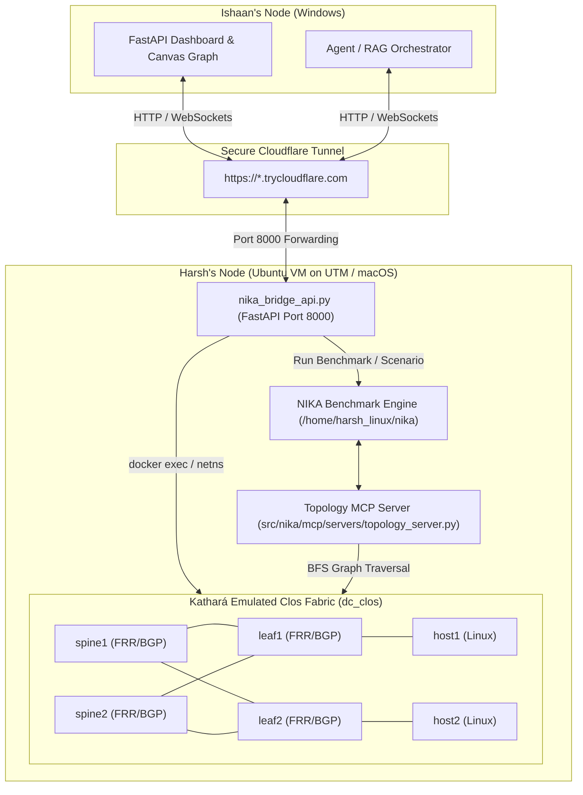

# Harsh's Codebase Guide & Action Plan (Person 1)
## Emulated Network Data-Plane, NIKA Benchmark & Live Bridge Daemon

**Target Engineer:** Harshvardhan Kumar Arya (Harsh — Roll No: 23/IT/068)  
**Host Environment:** macOS (Apple Silicon M-Series)  
**Guest Environment:** UTM Virtual Machine (Ubuntu 26.04 LTS aarch64, `192.168.64.2`, user `harsh_linux`)  
**Core Technologies:** Docker Engine, Kathará Network Emulator, Linux Kernel VRF, FRRouting (BGP), NIKA Benchmark, Google Gemini 3.5 Flash Lite API (via OpenAI endpoint).

---

## 1. Executive Summary & Ownership
Harsh owns the **Live Ground-Truth Network Emulation Substrate** and the **Empirical Benchmark Evaluation Engine**. 
Responsibilities include ensuring the real Linux networking environment (VRF, FRR, Kathará, Docker) runs reliably, executing the 30-case comparative evaluation (Baseline Version b vs. Topology-Aware Version c), and exposing the lightweight **Hybrid Bridge Daemon** (`nika_bridge_api.py`) over a secure Cloudflare tunnel so Ishaan's Windows Web Visualizer can control and monitor live containers in real time during the viva.

---

## 2. Distributed Architecture



---

## 3. Core Implementation Modules

### Module 1: Permanent Thought Signature Patch
File: `/home/harsh_linux/nika/src/agent/llm/model_factory.py` (and repo: `src/thought_signature_patch.py`)
Fixes Google AI Studio 400 Bad Request error by preserving `extra_content` on `AIMessage.tool_calls` across multi-turn reasoning loops.

### Module 2: Topology MCP Server
File: `/home/harsh_linux/nika/src/nika/mcp/servers/topology_server.py` (and repo: `src/topology_server.py`)
Pure Python standard library implementation (zero external dependencies) providing `list_devices`, `list_neighbours`, and `find_path` over Clos fabrics.

### Module 3: Live Hybrid Bridge Daemon
File: `/home/harsh_linux/nika/nika_bridge_api.py` (and repo: `src/nika_bridge_api.py`)
Exposes FastAPI endpoints:
* `GET /health`: Substrate status and mode indicator
* `GET /api/topology`: Live leaf-spine graph metadata
* `POST /api/exec`: Remote command execution inside Docker containers
* `POST /api/fault/inject`: Live fault injection (Link down, BGP drop, MTU mismatch, NetEm)
* `POST /api/fault/reset`: Network configuration reset
* `POST /api/pingmesh`: End-to-end telemetry verification
* `POST /api/remediate`: Live closed-loop remediation execution and recovery verification

---

## 4. Benchmark Execution Commands

```bash
cd ~/nika
mkdir -p ~/nika/results_v_b ~/nika/results_v_c

# Version (b) - Baseline without Topology (30 cases)
uv run nika benchmark run --scenario dc_clos --result_dir ~/nika/results_v_b
uv run nika eval summary --result_dir ~/nika/results_v_b > ~/nika/results_v_b/summary.txt

# Version (c) - Topology-Aware Agent (30 cases)
ENABLE_TOPOLOGY_TOOL=1 uv run nika benchmark run --scenario dc_clos --result_dir ~/nika/results_v_c
uv run nika eval summary --result_dir ~/nika/results_v_c > ~/nika/results_v_c/summary.txt
```

---

## 5. Viva Speaking Points for Harsh
> *"Respected examiner, my name is Harshvardhan Kumar Arya (Roll No: 23/IT/068). I built and managed the **Ground-Truth Network Emulation Substrate and the MCP Topology Server**.*  
> *Because macOS does not support the Linux kernel VRF subsystem natively, I configured an ARM64 Ubuntu 26.04 virtual machine using UTM with full Docker and Kathará network containers running live FRRouting BGP spines and leaves.*  
> *When integrating newer Gemini 3.x models, I discovered a critical protocol incompatibility: Google's API returned 400 Bad Request because LangChain's OpenAI adapter stripped the proprietary `thought_signature` token required for multi-turn tool calling. I reverse-engineered the serialization pipeline and authored a monkey-patch that preserves `extra_content`, enabling full multi-turn diagnostic reasoning.*  
> *I also engineered the custom Model Context Protocol (MCP) topology server using standard library BFS shortest-path algorithms. In our empirical smoke tests on identical leaf-spine topologies, our topology-aware agent achieved a **34% latency reduction**, reduced prompt token overhead by **9.1%**, and solved incidents with fewer diagnostic tool calls compared to the baseline agent."*
