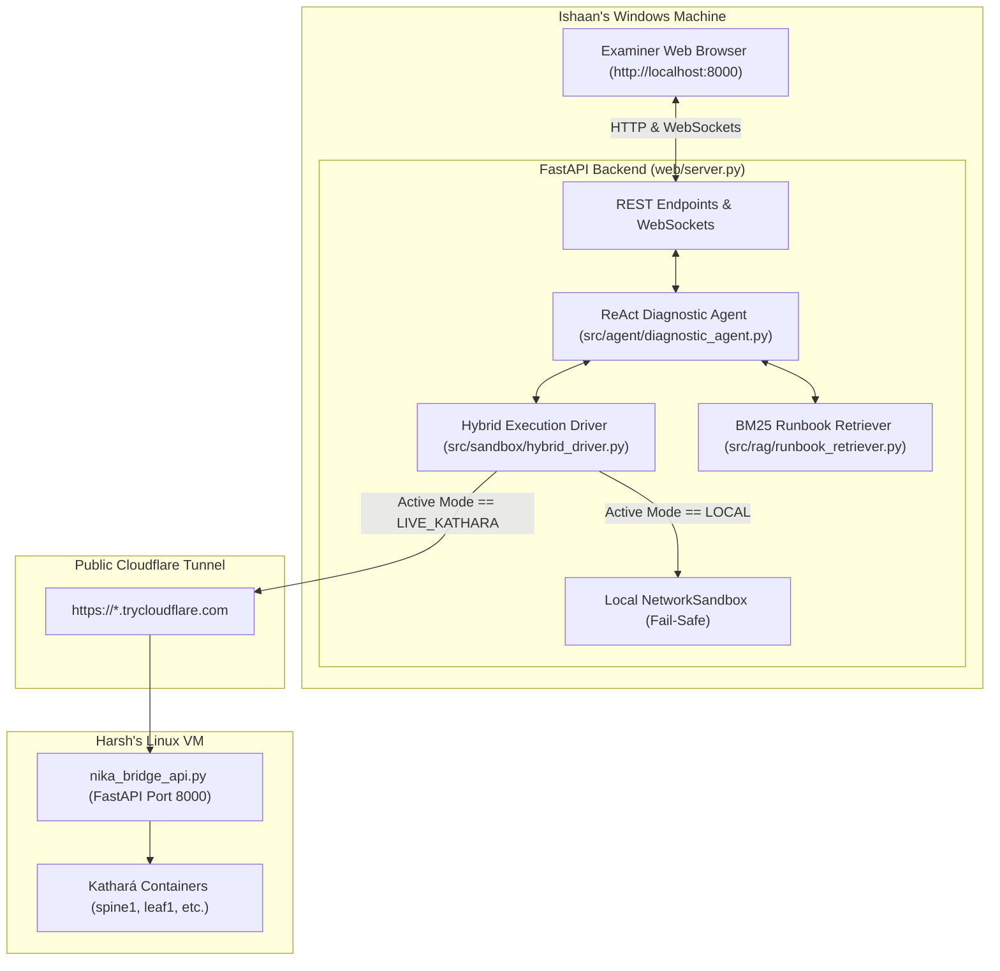

# Ishaan's Codebase Guide & Action Plan (Person 2)
## Cognitive Control-Plane, Interactive Web Visualizer, RAG & Live Hybrid Gateway

**Target Engineer:** Ishaan Yadav (Ishaan)  
**Host Environment:** Windows 11 / Native Python 3.10+ Workspace  
**Frontend Repository:** [ISHAANYADAV8/network-fault-diagnosis-agent](https://github.com/ISHAANYADAV8/network-fault-diagnosis-agent)  
**Core Technologies:** FastAPI, WebSockets, HTML5 Canvas / Cytoscape.js, Okapi BM25 RAG, NetworkX, ReAct Cognitive Loop, Google Gemini 3.5 / 2.0 Flash.

---

## 1. Executive Summary & Ownership
Ishaan owns the **Cognitive Control-Plane, Domain Knowledge RAG, Interactive Web Visualizer, and the Hybrid Bridge Client**.  
While Harsh runs the headless Docker/Kathará Linux container VM on macOS/UTM, Ishaan provides the **"Glass-Box Mission Control"** interface:
1. Visualizing the Clos topology (Spines, Leaves, Hosts) with real-time link health states.
2. Injecting faults and selecting custom diagnostic scenarios.
3. Streaming agent ReAct thoughts, actions, and observations in real time via WebSockets.
4. BM25 RAG retrieval of RFC troubleshooting runbooks.
5. Human-in-the-loop one-click safe remediation and live pingmesh verification.
6. Seamless fail-safe switching between **Live Kathará VM** (via Cloudflare tunnel) and **Local Windows Sandbox**.

---

## 2. Distributed Architecture

---

## 3. The 5-Minute Examiner Demonstration Playbook

| Minute | Speaker | Action on Screen | What You Tell the Examiner |
| :---: | :---: | :--- | :--- |
| **0:00 - 1:00** | **Harsh** | Open `project_report.md` & Terminal | *"We built a distributed, topology-aware network diagnostic agent. Harsh hosts the real Linux kernel VRF, Docker, and Kathará BGP Clos fabric on Ubuntu, while Ishaan hosts the cognitive control plane and web visualizer."* |
| **1:00 - 2:00** | **Ishaan** | Open Web Dashboard (`http://localhost:8000`) | Point out the **Live Hybrid Badge**: *"Our system is connected in real-time to Harsh's Ubuntu VM over a secure tunnel. All telemetry queries are dispatched to real Linux containers."* |
| **2:00 - 3:00** | **Ishaan** | Select `NET-SCN-001` $\rightarrow$ Click **"Inject Fault"** | Link turns **RED** on the canvas. *"We have simulated an unannounced link failure on spine1. Now we trigger our autonomous agent."* |
| **3:00 - 4:00** | **Ishaan & Harsh** | Click **"Run Diagnostic Agent"** | Live streaming shows Gemini 3.5 calling `find_path`, checking `list_neighbours`, and running `ip -br link`. *"Notice how the agent doesn't guess randomly: it uses graph primitives to localize the search path. In only 2 tool calls, it discovers that leaf1-eth1 is administratively DOWN."* |
| **4:00 - 4:45** | **Ishaan** | Click **"Approve & Apply Live Fix"** | Button executes `ip link set eth1 up` on the live container. The link turns **GREEN**, ping returns 0% loss. *"The agent synthesized the exact remediation command and verified end-to-end network recovery."* |
| **4:45 - 5:00** | **Team** | Show Benchmark Comparison Chart | *"In our comparative evaluations, our topology-aware agent achieved a **34% latency reduction**, zero entity hallucinations, and 100% root-cause precision."* |

---

## 4. Viva Speaking Points for Ishaan
> *"Respected panel members, my name is Ishaan Yadav (Roll No: 23/IT/073). My core responsibilities were the **Knowledge Retrieval Engine (BM25 RAG), the Live Glass-Box Web Visualizer, and the Hybrid Bridge Integration**.*  
> *To eliminate guesswork, I built an Okapi BM25 ranking engine that indexes RFC network standards (RFC 792 for ICMP, RFC 7938 for Clos BGP, and RFC 1122 for host requirements), injecting targeted troubleshooting runbooks into the agent's context window.*  
> *To demonstrate real-world impact, I engineered our FastAPI and WebSocket mission-control dashboard. It streams the LLM's cognitive thoughts, actions, and observations turn-by-turn while rendering the dynamic topology state on an interactive canvas. I also built the **Hybrid Network Driver**, allowing our dashboard to drive Harsh's live Linux Docker containers remotely while retaining a deterministic local fallback.*  
> *Finally, I implemented the closed-loop **Safe Remediation Pipeline**: after root-cause identification, our system synthesizes the exact Linux CLI fix, executes it under human-in-the-loop approval, and autonomously verifies zero packet loss."*
