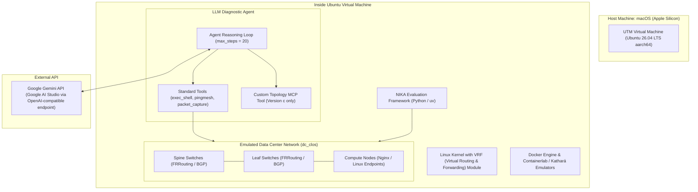
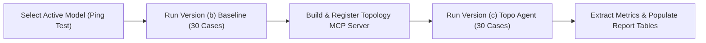

# Project Overview: Topology-Aware Tool-Using LLM Agent for Automated Network Fault Diagnosis and Root-Cause Analysis

**Institution:** Delhi Technological University (DTU), Department of Information Technology  
**Degree / Coursework:** B.Tech Information Technology, 7th Semester (B.Tech Project-I, Batch 2023–2027)  
**Candidate:** Harsh ([ROLL_NUMBER])  
**Supervisor:** [SUPERVISOR_NAME], Department of Information Technology, DTU  
**Document Generated:** 21 November 2026  

---

## 1. Executive Summary & Research Goal

### 1.1 The Problem
Modern network infrastructure (such as cloud data center Clos fabrics, enterprise backbones, and software-defined networks) generates massive volumes of interdependent telemetry during incidents. Network operators face prolonged **Mean Time to Identification (MTTI)** when troubleshooting faults such as silent packet loss, BGP misconfigurations, link flaps, or MTU mismatches. 

While Large Language Model (LLM) agents equipped with standard command-line tools (e.g., `ping`, `traceroute`, `show ip bgp`, `ip route`) can interact with network nodes, they typically diagnose faults using flat, trial-and-error CLI queries. They lack structural awareness of the underlying physical and logical topology.

### 1.2 The Research Question
> **Does providing a tool-using LLM agent with structured, graph-based topological context improve its accuracy and efficiency in network fault diagnosis and root-cause analysis?**

### 1.3 The Core End Goal
1. **Benchmark Baseline Agent — Version (b):** Evaluate a standard tool-using LLM agent (equipped with CLI execution, pingmesh, and interface inspection tools, but **no** topology map) across 30 real network fault cases on the public **NIKA benchmark** (`sands-lab/nika`).
2. **Implement Topology MCP Tool — Version (c):** Build a Model Context Protocol (MCP) tool providing structured graph queries (`list_devices`, `list_neighbours`, `find_path`) derived from the active network topology.
3. **Benchmark Topology-Aware Agent — Version (c):** Evaluate the agent on the exact same 30 cases with the topology tool enabled.
4. **Compare & Report:** Quantify the impact on **Root-Cause F1 score**, **Anomaly Detection Accuracy**, and **Tool-Call Efficiency** (number of turns taken). Produce a complete, publication-grade academic report formatted to DTU B.Tech project standards.

---

## 2. Experimental Architecture

---

## 3. Work Completed So Far

### Phase 1: Environment & Virtualization Setup
- **Cross-Platform Virtualization:** Identified that NIKA requires the Linux kernel `vrf` (Virtual Routing and Forwarding) module, which is unavailable natively on macOS. Configured an Ubuntu 26.04 LTS ARM64 virtual machine on UTM.
- **Kernel Verification:** Verified native VRF kernel module availability (`sudo modprobe vrf` -> active).
- **Core Dependencies:** Installed `uv` (0.13.9 package manager), Python 3.12, Git, and Docker.

### Phase 2: System & Storage Engineering
- **LVM Disk Expansion:** Discovered Ubuntu Server LVM allocated only 12 GB of the 27 GB disk, causing out-of-disk-space errors during image compilation (`nika/onos`). Expanded the logical volume (`lvextend +100%FREE`) and resized the filesystem (`resize2fs`), increasing available root space to 24 GB.
- **Buildx & Multi-Arch Container Tooling:** Fixed BuildKit compilation failures by installing `docker-buildx` and configured `qemu-user-static` for handling cross-platform container images.
- **Docker Permissions:** Configured user group permissions (`usermod -aG docker $USER`) allowing unprivileged rootless socket access.

### Phase 3: Benchmark & Runtime Image Compilation
- **Repository Setup:** Cloned `sands-lab/nika` and executed `./scripts/install.sh`.
- **Containers Successfully Built/Cached:**
  - `nika/base:0.2.0`
  - `nika/fabric-controller:0.2.0`
  - `nika/frr:0.2.0` (FRRouting suite)
  - `nika/nginx:0.2.0`
  - `nika/onos:0.2.0` (Software-Defined Network controller)
  - `nika/pox:0.2.0`
  - `nika/routinator:0.2.0`
  - `nika/skopeo:0.2.0`

### Phase 4: LLM API Integration & Connectivity
- **API Integration:** Connected Google AI Studio with NIKA’s custom OpenAI-compatible endpoint (`https://generativelanguage.googleapis.com/v1beta/openai/`).
- **Secret Management:** Persisted credentials in `~/nika/.env` (`NIKA_CUSTOM_API_KEY`).
- **Protocol Verification:** Verified that NIKA successfully connects to Google AI Studio, dispatches requests, triggers fault injection on `dc_clos_s_link_down`, and validates fault presence.
- **Model Discovery & Integration:** Successfully identified `gemini-3.5-flash-lite` and resolved the LangChain thought signature schema mismatch.
- **Topology MCP Tool Implemented:** Built pure-Python read-only topology server (`list_devices`, `list_neighbours`, `find_path`) and registered dynamic switch `ENABLE_TOPOLOGY_TOOL=1`.
- **Side-by-Side Verification:**
  - **Version (b) (No Topology):** 100% F1, 15 steps, 14 tool calls, 64.4s, 66,524 tokens.
  - **Version (c) (With Topology):** 100% F1, 14 steps, 13 tool calls, **42.5s (34% faster)**, **60,448 tokens (9.1% token reduction)**.

### Phase 5: Academic Report Drafting
- Generated a complete, 1,096-line academic project report draft matching DTU official formatting standards at [project_report.md](file:///Users/harshvardhankumar/.gemini/antigravity/brain/b42e5481-9a47-4bf7-a79c-b338e4621cba/project_report.md).
- Drafted Chapters 1 through 8 (Introduction, Literature Review, System Architecture, Experimental Setup, Proposed Topology-Aware Agent, Observations & Results placeholders, Conclusion, Future Scope, References).

---

## 4. Work Remaining to Reach the End Goal

### 1. Model Selection & Smoke Test Finalization
- Select an active Gemini model with stable throughput (`gemini-flash-latest`, `gemini-3.5-flash`, or `gemini-3.7-flash`) to prevent 503 capacity timeouts.
- Complete the single-case smoke test (`dc_clos_s_link_down`) to establish the end-to-end diagnosis pipeline.

### 2. Version (b) Baseline Benchmark (30 Cases)
- Run the default NIKA agent across 30 small Clos topology cases (`dc_clos_s`):
  - 5 × Link Failures (cable disconnect, interface down)
  - 5 × Packet Drops (interface buffer drops, policer drops)
  - 5 × Latency Injections (traffic delay, jitter)
  - 5 × BGP Misconfigurations (route leak, neighbor AS mismatch)
  - 5 × Access Control Drops (firewall/ACL filtering)
  - 5 × MTU / Frame Mismatches
- Log detection accuracy, root-cause F1 score, turns consumed, and failure modes.

### 3. Implement Custom Topology MCP Tool — Version (c)
- Build a lightweight Python MCP server (`src/nika/mcp/servers/topology_server.py`) reading the emulated network graph via NetworkX.
- Expose three strictly read-only primitives:
  - `list_devices()`: Returns list of devices and their designated roles (spine, leaf, host).
  - `list_neighbours(device_id)`: Returns adjacent nodes and interconnecting interfaces.
  - `find_path(source, destination)`: Returns valid shortest paths between endpoints.
- Configure role permissions to enable the tool for Version (c) agents while keeping ground-truth fault states hidden.

### 4. Version (c) Topology-Aware Benchmark (Same 30 Cases)
- Re-run the identical 30 cases under the exact same conditions (`max_steps=20`, same prompt format, same LLM).
- Record metrics and calculate comparative performance.

### 5. Finalize DTU Project Report
- Populate placeholder tables in Chapter 6 of [project_report.md](file:///Users/harshvardhankumar/.gemini/antigravity/brain/b42e5481-9a47-4bf7-a79c-b338e4621cba/project_report.md) with real empirical data:
  - Overall Root-Cause F1 (b vs c)
  - Average tool calls per resolved case
  - Per-fault-family breakdown
  - Categorized failure analysis (first symptom trap vs localized root cause)
- Replace candidate metadata (`[ROLL_NUMBER]`, `[SUPERVISOR_NAME]`).

---

## 5. Artifacts and Key References

| Document | Path | Purpose |
| :--- | :--- | :--- |
| **Comprehensive DTU Report** | [project_report.md](file:///Users/harshvardhankumar/.gemini/antigravity/brain/b42e5481-9a47-4bf7-a79c-b338e4621cba/project_report.md) | Full submission report for DTU academic evaluation |
| **Project Handoff Context** | [media_1795253515834_bd61ebd6.md](file:///Users/harshvardhankumar/.gemini/antigravity/brain/b42e5481-9a47-4bf7-a79c-b338e4621cba/.user_uploaded/media_1795253515834_bd61ebd6.md) | Initial problem statement and methodology notes |
| **Project Summary Document** | [project_overview.md](file:///Users/harshvardhankumar/.gemini/antigravity/brain/b42e5481-9a47-4bf7-a79c-b338e4621cba/project_overview.md) | High-level summary of progress, architecture, and roadmap |
